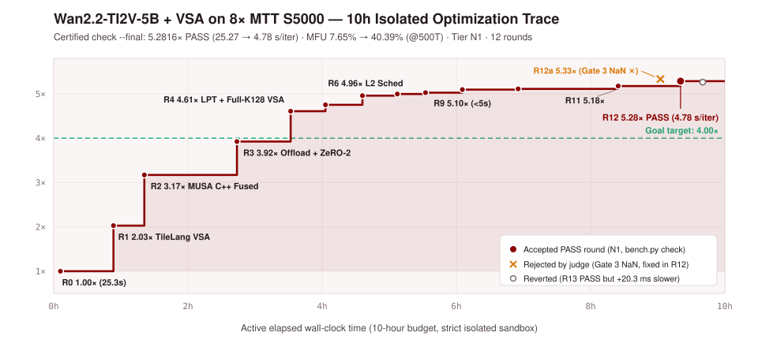
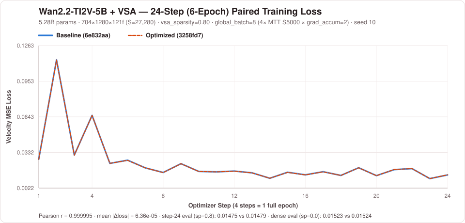

# Faster-Wan22-VSA-MUSA

**5.28× faster** full-parameter finetuning of **Wan2.2-TI2V-5B + Video Sparse Attention (VSA)** on **8× Moore Threads MTT S5000** (`25.266 → 4.784 s/iter`, certified `PASS` at Tier `N1` under the [ResearchBoost-Agent](https://github.com/DAGroup-PKU/ResearchBoost-Agent) frozen judge).

All custom TileLang-MUSA block-sparse VSA kernels and MUSA C++ (`mcc`) fused kernels were authored autonomously from scratch inside a strict read-only sandbox (10-hour budget, Antigravity + Gemini 4 Neon (XHigh)) with zero access to prior custom kernels.

---

## Certified Results (`bench/bench.py check --final`)

| Metric | Baseline (`6e832aa`) | Optimized (`3258fd7`) | Delta |
|---|---:|---:|---:|
| **Step time (`ref_a / cand / ref_b`)** | `25.2660 s/iter` (`25.2639` / `25.2682`, spread `0.02%`) | **`4.7837 s/iter`** (spread `0.15%`) | **`5.2816×` (`5.28×`)** |
| **Effective MFU (`@500T` BF16)** | `7.65%` (`38.23 TFLOPS/GPU`) | **`40.39%`** (`201.93 TFLOPS/GPU`) | **`+32.74 pp`** |
| **GPU Busy / Kernel Launches** | `25,219 ms` / `34,054` launches | `4,753 ms` (`99.4%` busy) / **`4,470`** launches | **`-86.9%` launches** |
| **Peak HBM (`80 GiB`/GPU)** | `56.19 GiB` alloc / `56.70 GiB` res | `68.60 GiB` alloc / `75.43 GiB` res | fits in 80 GiB |
| **Gate 2 (2-step deterministic)** | `71,008 / 71,008` bitwise ref | `15,992 / 71,008` bitwise, **`0` exact failures**, `0` dtype changes | **Tier `N1`** |
| **Gate 3 (6-step trajectory, `±3σ`)** | 6-seed frozen ref (`seeds 10..15`) | `loss_tail = -0.034σ`, `gate_top10_step1 = -0.350σ` | **`PASS (equivalent)`** |
| **Extended 24-step (6-epoch) E2E** | eval MSE `0.03398 → 0.01475` (`sp=0.8`) / `0.02833 → 0.01523` (`sp=0.0`) | eval MSE `0.03396 → 0.01479` (`sp=0.8`) / `0.02834 → 0.01524` (`sp=0.0`) | **`mean \|Δloss\| = 6.36e-5`** |



---

## Workload & Upstream Provenance

- **Upstream model**: Official [`Wan-AI/Wan2.2-TI2V-5B`](https://huggingface.co/Wan-AI/Wan2.2-TI2V-5B) (30 DiT blocks, `dim=3072`, `ffn_dim=14336`, `24` heads × `128`, `5,282,995,392` trainable parameters including 30 zero-initialized VSA compression gates) + Video Sparse Attention following [`hao-ai-lab/FastVideo`](https://github.com/hao-ai-lab/FastVideo) (`vsa_sparsity=0.80`, `topk=96` of `480` `(4,4,4)` blocks).
- **Baseline port**: Pure PyTorch + FSDP2 port to 8× MTT S5000 at commit `6e832aa` (preserved on branch [`baseline`](../../tree/baseline) and diffed in [`patches/wan22_vsa_r1_to_r12.patch`](patches/wan22_vsa_r1_to_r12.patch)).
- **Training recipe**: `704×1280×121f` (`48×31×44×80` latents, `S=27,280` tokens), `batch_size=1`/GPU (`global_batch=8`), Rectified Flow Matching velocity MSE loss (`flow_shift=5.0`), FSDP2 BF16 compute + FP32 master weights, FP32 gradient reduction, FP32 AdamW (`lr=1e-5`, `weight_decay=0.01`, `max_grad_norm=1.0`).
- **Public data provenance**: 32 deterministic procedurally-generated RGB videos + 32 text prompts encoded through the **real** `Wan2.2_VAE.pth` and **real** `UMT5-XXL` encoder via [`wan22_vsa_s5000/scripts/prepare_dataset.py`](wan22_vsa_s5000/scripts/prepare_dataset.py). Zero private data.

---

## Key Optimizations (12 Accepted Rounds)

1. **From-scratch TileLang-MUSA block-sparse VSA (`wan22_vsa/vsa_kernels.py`)**: Zero KV materialization + zero-atomic deterministic KV-CSR, direct layout-matched `K=128` backward tiling, L2-coherent 4-quantile `QOrder` + bucket-8 LPT scheduling, `BN=256` fused-scale forward, branchless 4-tile `vbs` masking, and clamp-safe `T.min(S - lse, 1.0)` `dQ` backward (fixing an edge-case `lse < -127` `NaN` caught by Gate 3 in `R12a`). Cut VSA core from **`15,826 ms → 1,991 ms` (`-87.4%`)** and freed **`33.5 GiB` HBM** in Round 1.
2. **Async pinned-CPU activation offload + static GPU ring pools (`wan22_vsa/offload.py`)**: Eliminated all forward GEMM, VSA, and Cross-Attention recomputation with GELU-only recompute; `2.77 s` PCIe DMA is 100% overlapped with compute and static pools cut HBM fragmentation from `10.65 → 6.32 GiB`.
3. **Pure-scalar MUSA C++ (`mcc`) fused kernels (`wan22_vsa/fused_ops.py`, `wan22_vsa/optim.py`)**: Fused 1-warp/row forward norms, shared-memory-accumulated backward norms, RoPE, GELU-tanh+bias, 7-linear fused bias grads, warp-ballot Top-K / bitonic `QOrder`, VSA TilePool/CombineUntile, and 1-pass FP32 AdamW (`5,184 ms → ~410 ms`, `-92%`).
4. **Bucketed FSDP2 ZeRO-2 (`bpb=5`, `reshard_after_forward=False`)**: Cut collective + FSDP pack/unpack time from `463 ms → 236 ms` (`-49%`).

See [`TRACE.md`](TRACE.md), [`WORK_LOG.md`](WORK_LOG.md), and [`SUPERVISOR.md`](SUPERVISOR.md) for the full 12-round engineering record.

---

## End-to-End Training Validation (24 Steps / 6 Full Epochs)



Over 24 real optimizer steps (6 full epochs, `global_batch=8`, seed `10`), baseline (`6e832aa`) and optimized (`3258fd7`) training trajectories overlap closely (`mean |Δloss| = 6.36e-5`, `max |Δloss| = 1.52e-4`) and converge to nearly identical held-out evaluation MSE on both sparse (`sp=0.80`: `0.014753` vs `0.014785`, `0.22%` rel diff) and dense (`sp=0.00`: `0.015232` vs `0.015236`, `0.027%` rel diff) attention. Full details in [`docs/e2e_validation.md`](docs/e2e_validation.md) and [`docs/e2e_validation.json`](docs/e2e_validation.json).

---

## Reproducing on 8× MTT S5000

### Prerequisites
- 8× Moore Threads MTT S5000 (80 GiB HBM/GPU), MUSA 5.2.0 driver/SDK (`mcc` with `--offload-arch=mp_31`)
- PyTorch `2.9.1.post1+musa5.2.0`, `torch_musa`, `mate 0.2.5`, `tilelang-musa 0.1.8+musa.3`, `transformers`, `safetensors`, `einops`
- `DiffSynth-Studio` (used only once by `scripts/prepare_dataset.py` to load `Wan2.2_VAE.pth` and `UMT5-XXL`)

### 1. Prepare public weights, dataset, and baseline reference tree
```bash
export ASSETS="$PWD/assets"
export DIFFSYNTH_PATH=/path/to/DiffSynth-Studio   # if not pip-installed
# Set USE_MODELSCOPE=1 to download Wan-AI/Wan2.2-TI2V-5B from ModelScope instead of HuggingFace
bash scripts/prepare_assets.sh
```

### 2. Freeze reference timing/records/trajectories and run `bench.py check --final`
```bash
export ASSETS="$PWD/assets"
bash scripts/freeze_judge_and_verify.sh
```

### 3. Direct 8-GPU training with the optimized code
```bash
MODEL_DIR="$PWD/assets/models/Wan2.2-TI2V-5B" \
DATA_DIR="$PWD/assets/data/wan22_vsa_data_704x1280_121f" \
bash wan22_vsa_s5000/scripts/run_train_8gpu.sh --max_train_steps 100
```

---

## Repository Layout

```text
Faster-Wan22-VSA-MUSA/
├── README.md                          # Overview, results, and reproduction instructions
├── wan22_vsa_s5000/                   # Full optimized training codebase (opt branch 3258fd7)
│   ├── train.py                       # Entry point
│   ├── wan22_vsa/                     # Model, FSDP2, TileLang-MUSA VSA, MUSA C++ fused ops, offload, AdamW
│   └── scripts/                       # prepare_dataset.py & run_train_8gpu.sh
├── patches/wan22_vsa_r1_to_r12.patch  # Full diff from MTT S5000 baseline (6e832aa) -> R12 (3258fd7)
├── scripts/                           # prepare_assets.sh, freeze_judge_and_verify.sh, run_e2e_validation.py
├── docs/                              # Extended 24-step E2E validation report, JSON, and loss-curve SVG
├── bench/ & numerics/                 # Frozen RBA judge & MUSA numerics verifier
├── task/                              # Formulation, baseline profile, timing/traj refs, final_check.json
└── GOAL.md / TRACE.md / WORK_LOG.md / SUPERVISOR.md / trace.json / trace-progress.svg
```
