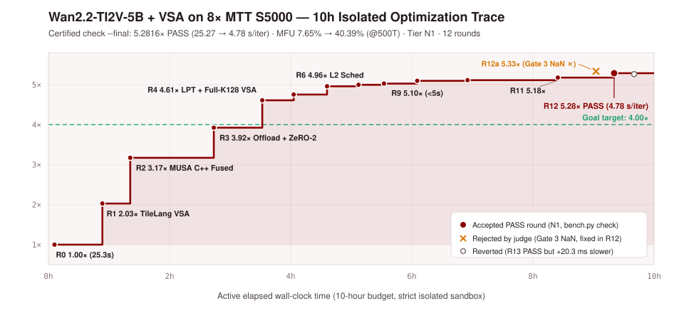

# Wan2.2-TI2V-5B + VSA on 8× MTT S5000 — Optimization Trace

*End-to-end training optimization trace for `wan22-vsa-s5000` (5.28B-parameter video DiT with 80% Video Sparse Attention, BF16 compute + FP32 master/AdamW, 8× Moore Threads MTT S5000), executed under strict container isolation with zero access to prior custom kernels. Internal GPU microarchitecture specifications, instruction names, and proprietary vendor kernel symbols have been redacted.*

**Verdict: `PASS` (`final=true`, `met_target=true`) — `5.2816×` certified speedup (`25.2660 → 4.7837 s/iter`), Tier `N1` (`equivalent`).**

---

## Run Summary

| Metric | Value |
|---|---|
| **Judged speedup (`check --final`)** | **`5.2816×`** (`ref_a 25.2639 s`, `cand 4.7837 s`, `ref_b 25.2682 s`; ref spread `0.02%`, cand spread `0.15%`) |
| **Effective MFU (vs 500 TFLOPS BF16)** | **`7.65% → 40.39%`** (`38.23 → 201.93 TFLOPS/GPU`; effective model FLOPs `~966 TFLOPs/GPU/step`, `3×` fwd without GC) |
| **Self-best (`check`, frozen ref)** | **`5.2854×`** (`25.2887 → 4.7846 s/iter`, commit `3258fd7`, Round 12) |
| **Goal target / minimum** | `4.00×` target (`<= 6.32 s/iter`) / `2.50×` minimum — **exceeded target by +32%** |
| **Correctness & Tier** | **`PASS` — Tier `N1` (`equivalent`)** (`71,008` tensors checked, `0` exact failures; `traj_s10`: `loss_tail = -0.034σ`, `gate_top10_step1 = -0.350σ` vs `±3σ` bound) |
| **Peak HBM (`80 GiB`/GPU)** | **`68.60 GiB`** allocated / **`75.43 GiB`** reserved (`56.19 / 56.70 GiB` baseline) |
| **Rounds** | **`12` accepted `PASS` commits** (`R1`–`R12`) + `1` Gate 3 rejection (`R12a`) + `1` reverted regression (`R13`) |
| **Time budget / active elapsed** | `10.0 h` budget / **`9.8 h`** active runtime (`2.70 GPU-hours` for `check --final`) |
| **LLM usage** | `373` requests · **`94.37 M`** input tokens (**`96.1%`** cached, `3.65 M` uncached) · **`1.41 M`** output tokens (`472.7 K` thinking) |
| **Sandbox tool calls** | **`760`** total (`bash: 291`, `read_file: 271`, `edit_file: 145`, `write_file: 41`, `grep: 8`, `list_dir: 4`) |
| **Integrity** | `evaluator_sha256` intact (`96/96` files), frozen inputs verified at start & end, clean `opt` branch (`3258fd7`) |

*Machine-readable telemetry and per-round data: [`trace.json`](trace.json). Full engineering log: [`WORK_LOG.md`](WORK_LOG.md). Final A-B-A certification record: [`task/final_check.json`](task/final_check.json).*

---

## 1. Key Levers (Kept vs. Rejected)

### Kept (`✓`)

| Status | Lever | Rounds | Verified Impact |
|---|---|---|---|
| `✓` | **From-scratch TileLang-MUSA block-sparse VSA** (zero KV materialization + zero-atomic deterministic KV-CSR) | R1, R4, R6, R11, R12 | VSA core `15,826 ms → 1,991 ms` (**`-87.4%`**); freed **`33.5 GiB`** HBM in R1 alone |
| `✓` | **Pure-scalar MUSA C++ (`mcc`) fused norms, RoPE, GELU+bias, VSA pre/post & 1-pass FP32 AdamW** | R2, R5, R7, R8, R9, R10 | Unfused elementwise / norm / cast / sort / optim `5,184 ms → ~410 ms` (`-92%`) |
| `✓` | **Async pinned-CPU activation offload + static GPU ring/staging pools + GELU-only recompute** | R3, R5, R8, R10, R11 | Eliminated all forward GEMM, VSA, and Cross-Attention recompute; `2.77 s` PCIe DMA **100% overlapped**, zero allocator stalls |
| `✓` | **Bucketed FSDP2 ZeRO-2 (`bpb=5`, `reshard_after_forward=False`)** | R3 | Distributed collective + FSDP pack/unpack cut from `463 ms → 236 ms` (`-49%`) |
| `✓` | **Direct layout-matched `K=128` VSA tiling + L2-coherent 4-quantile `QOrder` + bucket-8 LPT** | R4, R6, R7 | Eliminated real-video KV degree skew and redundant shared-memory transpose copies (**`-1.18 s`** combined) |
| `✓` | **`BN=256` fused-scale forward + register-hoisted `dQ` + branchless VBS & clamp-safe `dQ`** | R11, R12 | Final **`-162 ms`** push (`4.947 → 4.784 s/iter`) while resolving `R12a` Gate 3 `NaN` |

### Rejected / Reverted (`✗`)

| Status | Attempted Optimization | Rounds | Why Rejected |
|---|---|---|---|
| `✗` | **Unmasked `vsa_bwd_dq` (`R12a`)** | R12a | Measured `5.3317×` (`4.7431 s`) and matched Gate 2 bitwise across `71,008` tensors, but **caught by Gate 3 (`traj_s10` step 1 `NaN`)** when `lse < -127` evaluated `exp2(0 - lse) = +Inf * 0.0 = NaN`; replaced by bitwise-exact clamp-safe `R12` |
| `✗` | **FSDP2 comm-overlap toggle, non-default MCCL bucket/channel sweeps (`bpb=6/10`)** | R7, R10, R13+ | Contended with compute or increased collective overhead in `bench.py time` (`+0.8` to `+172 ms`) |
| `✗` | **Custom TileLang-MUSA Cross-Attention (`S_k=512`)** | R10 | `3.75×–3.9×` slower than native vendor FlashAttention (`92.2 ms`) on short KV sequences |
| `✗` | **Explicit shared-memory transpose copies, `threads=128`, `BN=192`, disabled pipelining** | R4, R11 | `+134` to `+439 ms` slower, TileLang layout divisibility error, or async barrier hang |
| `✗` | **CTA-uniform `need_clamp` fast/slow branch in `dQ` (`R13`) & pre-mask in `dKdV`** | R13 | Passed Gate 3 (`N1`), but `+20.3 ms` (`4.8049 s`) and `+37.6 ms` slower than branchless `R12`; cleanly reverted to `3258fd7` |

---

## 2. Highlight: What the Multi-Stage Judge Caught (`R12a → R12`)

In Round 12, profiling revealed that `27.1%` (`130/480`) of tiles on the `704×1280×121f` shape `(31, 22, 40)` are boundary partial blocks (`vbs ∈ {24, 32, 48}`), causing `71.7%` of `BN=256` forward iterations and `46.8%` of `BN=128` `dQ` iterations to enter nested `T.if_then_else` branches (`+116 ms` branch-predication tax).

1. **`R12a` (Fast, Gate 2 Bitwise, Caught by Gate 3)**: Because padded keys and values are zero (`K[j >= vbs] = 0`, `V[j >= vbs] = 0`), dropping the `vbs` mask in `vsa_bwd_dq` ran **`4.7431 s/iter` (`5.3317×`)** and matched `R11` across all `71,008` Gate 2 tensors. However, **Gate 3 (`traj_s10`) rejected it with `grad_norm = NaN` on step 1**.
2. **Root Cause**: On pretrained `Wan2.2-5B` QK-RMSNorm heads where a valid token has `lse[i] < -127`, a padded zero key produces `S_ij = 0`, so `exp2(0 - lse[i]) = +Inf`, and the matrix-multiply unit evaluates `+Inf * 0.0 = NaN`.
3. **Mathematical Fix (`R12`, Commit `3258fd7`)**: For every valid key `j < vbs`, `S_ij * scale_log2 - lse_i <= 0.0` strictly. Splitting `T.min(acc_s * scale_log2 - lse_reg[i], 1.0)` before `T.exp2(acc_s)` is **100% bitwise identical** on all valid keys, bounds every padded `exp2` term to `<= 2.0` (so `dS * 0.0 == 0.0` even at `lse = -700`), preserves vectorized `exp2` codegen, and removes all `Vbs` loads/branches in `dQ`. Combined with branchless 4-tile arithmetic masking in `vsa_fwd_bn256`, `R12` cut **`-102.0 ms`** (`4.8866 → 4.7846 s/iter`) and matched `R11`'s Gate 3 trajectory to all 17 decimal digits.

---

## 3. Round-by-Round Timeline

| Round | Active Elapsed | Commit | `s/iter` | Speedup | Peak HBM (Alloc / Res) | Verdict | Main Change |
|---|---:|---|---:|---:|---:|---|---|
| **R0 (Ref)** | `0.10 h` | `6e832aa` | `25.2887 s` | `1.0000×` | `56.19 / 56.70 GiB` | `BASELINE` | Stock Python gather/scatter VSA + masked FA + unfused FP32 ops + full GC + ZeRO-3 (`34,054` launches/step) |
| **R1** | `0.89 h` | `9f5a40b` | `12.4750 s` | `2.0271×` | `22.72 / — GiB` | `PASS` (`N1`) | From-scratch TileLang-MUSA block-sparse VSA fwd/bwd + zero-atomic deterministic KV-CSR (`-33.5 GiB` HBM) |
| **R2** | `1.35 h` | `f4118f6` | `7.9739 s` | `3.1714×` | `18.92 / — GiB` | `PASS` (`N1`) | From-scratch pure-scalar MUSA C++ fused AdaLN/LN/Res/RMSNorm+RoPE & VSA TilePool/CombineUntile |
| **R3** | `2.73 h` | `1741071` | `6.4442 s` | `3.9243×` | `62.85 / 69.23 GiB` | `PASS` (`N1`) | Async pinned-CPU activation offload (static staging pool) + GELU-only recompute + bucketed FSDP2 ZeRO-2 (`bpb=5`) |
| **R4** | `3.53 h` | `f45b9f0` | `5.4875 s` | `4.6084×` | `62.85 / 69.23 GiB` | `PASS` (`N1`) | LPT descending-degree VSA `dK/dV` + direct layout-matched full-`K=128` `dQ/dK/dV` + 288-block KV-CSR (crossed `4.0×` target) |
| **R5** | `4.05 h` | `7ff6865` | `5.3212 s` | `4.7525×` | `64.13 / 72.85 GiB` | `PASS` (`N1`) | Cross-Attention async offload (0 CA recompute) + fused QKVG `addmm_`/bias-grad + 8-warp reduce + 1-pass FP32 AdamW |
| **R6** | `4.60 h` | `37eac32` | `5.0993 s` | `4.9593×` | `64.13 / 72.91 GiB` | `PASS` (`N1`) | L2-coherent VSA scheduling (4-quantile `QOrder` + ascending KV + bucket-8 LPT `dK/dV`) + `clear_accum` + async prefetch |
| **R7** | `5.12 h` | `62325e5` | `5.0616 s` | `4.9962×` | `64.13 / 73.94 GiB` | `PASS` (`N1`) | 16-bit BF16 warp-ballot Top-K + shared-memory bitonic `QOrder` + 64-bucket parallel LPT + 3-block async offload window |
| **R8** | `5.54 h` | `088fbf0` | `5.0315 s` | `5.0261×` | `64.31 / 74.96 GiB` | `PASS` (`N1`) | Fused GELU-tanh bwd+bias + static `754 MiB` FFN scratch + 7-linear fused bias grads + AdaLN skip-add fusion |
| **R9** | `6.09 h` | `d601204` | `4.9634 s` | `5.0950×` | `64.31 / 74.96 GiB` | `PASS` (`N1`) | 1-warp/row zero-barrier forward norms (4 kernels) + fused `reduce_sum2` & shared-memory-accumulated backward norms (`< 5.0 s/iter`) |
| **R10** | `6.92 h` | `0355829` | `4.9468 s` | `5.1122×` | `68.60 / 74.92 GiB` | `PASS` (`N1`) | Static 3-slot GPU ring buffers (`fc1`/`vsa`, cutting HBM fragmentation `10.65 → 6.32 GiB`) + fused VSA `db_v`/`db_gate` + 256-thread `tile_pool_fwd` |
| **R11** | `8.41 h` | `a5b1bbd` | `4.8866 s` | `5.1751×` | `68.60 / 75.37 GiB` | `PASS` (`N1`) | VSA fwd `BN=256` + fused `sm_scale` + register-hoisted `dQ` `lse/delta` + `grln_bwd` `P=240` + `blk29` static `fc1_last` scratch |
| **R12a** | `9.04 h` | — | `4.7431 s` | `5.3317×` | `68.60 / 71.12 GiB` | **`INCORRECT`** | Unmasked `dq_nomask`: caught by Gate 3 (`traj_s10` step 1 `NaN` on `lse < -127`) |
| **R12** | `9.34 h` | **`3258fd7`** | **`4.7846 s`** | **`5.2854×`** | **`68.60 / 75.33 GiB`** | **`PASS` (`N1`)** | Branchless 4-tile arithmetic `vbs` mask in `vsa_fwd_bn256` + clamp-safe `T.min(S-lse, 1.0)` in `vsa_bwd_dq_bn128` (**Final Best**) |
| **R13** | `9.67 h` | — | `4.8049 s` | `5.2631×` | `68.60 / 75.25 GiB` | `REVERTED` | CTA-uniform `need_clamp` branch in `dQ` passed (`N1`) but was `+20.3 ms` slower than branchless `R12`; reverted to `3258fd7` |
| **Final** | `10.0 h` | **`3258fd7`** | **`4.7837 s`** | **`5.2816×`** | **`68.60 / 75.43 GiB`** | **`PASS` (`N1`)** | Outer harness `bench.py check --final` A-B-A certification (`ref_a 25.2639 s`, `cand 4.7837 s`, `ref_b 25.2682 s`) |

---

## 4. Baseline vs. Final Kernel Category Breakdown

Comparing the initial baseline profile (`task/baseline.md`) against the final `R12` profile (`3258fd7`, `4,781.5 ms` window, `4,753.3 ms` GPU busy = **`99.4%`**, `2,773.4 ms` PCIe DMA 100% overlapped, median Stream 0 gap `1.6 us`):

| Category | Baseline (`R0`, ms) | Final (`R12`, ms) | Reduction | Final Status |
|---|---:|---:|---:|---|
| **VSA Sparse Attention (gather/scatter + attn)** | `15,826.0` | **`1,990.6`** | **`-87.4%`** | Custom TileLang-MUSA block-sparse VSA (`fwd 558.1`, `dq 605.7`, `dkdv 826.8 ms`) |
| **Linear / FFN GEMMs (`muBLAS`)** | `2,491.0` | **`1,941.3`** | **`-22.1%`** | Vendor BF16 GEMMs (`873` calls, 0 forward recompute) |
| **FSDP2 + MCCL (`AllGather` / `ReduceScatter`)** | `462.6` | **`236.1`** | **`-49.0%`** | Bucketed ZeRO-2 `bpb=5` (`RS 108.3`, `AG 64.0`, `pack/unpack 63.8 ms`) |
| **Cross-Attention (vendor FlashAttention)** | `~185.0` | **`96.3`** | **`-47.9%`** | Native vendor FlashAttention (`fwd 17.5`, `bwd 78.8 ms`, 0 recompute) |
| **Elementwise / Norms / RoPE / VSA Pre-Post / AdamW** | `6,254.0` | **`~410.0`** | **`-93.4%`** | Custom pure-scalar MUSA C++ (`GELU 122.3 ms`, `VSA pre/post 86.5 ms`, `1-warp/SMEM norms ~160 ms`, `1-pass AdamW 25.1 ms`) |
| **Residuals (`short` + other)** | — | **`~79.0`** | — | `short` = `4.39 ms` (`0.1%`), top repeated chain = `2.77 ms` (`0.06%`) |
| **Total GPU Busy Time** | **`25,218.6 ms`** | **`4,753.3 ms`** | **`-81.2%`** | **`82.7%`** of step time is BF16 GEMMs + sparse attention |
| **Kernel Launches / Step** | **`34,054`** | **`4,470`** | **`-86.9%`** | Eliminated `29,584` kernel launches per step |

---

## 5. Certification & Files

- **Task formulation & contract**: [`GOAL.md`](GOAL.md), [`GOAL_LINE.txt`](GOAL_LINE.txt), [`task/formulation.json`](task/formulation.json), [`task/baseline.md`](task/baseline.md)
- **Frozen judge & MUSA numerics adapter**: [`bench/`](bench/) (`bench.py`, `wan22_vsa_adapter.py`, `timing.py`, `kernel_util.py`, `recipe.py`), [`numerics/`](numerics/)
- **Agent & supervision records**: [`WORK_LOG.md`](WORK_LOG.md), [`SUPERVISOR.md`](SUPERVISOR.md), [`trace.json`](trace.json), [`task/final_check.json`](task/final_check.json)
