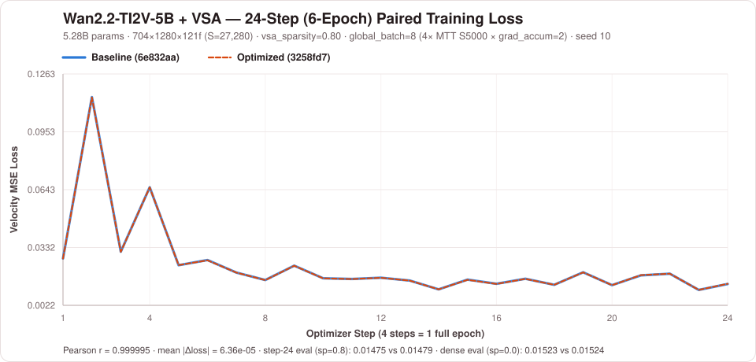

# End-to-End Training Validation (`Wan2.2-TI2V-5B + VSA`)

Beyond the frozen judge's 2-step bitwise check (Gate 2) and 6-step paired deterministic trajectory gate (Gate 3), we ran a **24-step (6 full epochs)** paired real training comparison between the unmodified MTT S5000 baseline (`6e832aa`) and the final R12 optimized candidate (`3258fd7`) on the full **5.28B-parameter** `Wan2.2-TI2V-5B + VSA` model (`704×1280×121f`, `S=27,280`, `vsa_sparsity=0.80`, `lr=1e-5`, `flow_shift=5.0`, `seed=10`).

## Configuration

| Item | Setting |
|---|---|
| **Baseline commit** | `6e832aa` (unmodified MTT S5000 port) |
| **Optimized commit** | `3258fd7` (Round 12 final candidate) |
| **Model & shape** | `Wan2.2-TI2V-5B + VSA` (30 layers, 5,282,995,392 trainable params, `48×31×44×80` latents, `S=27,280`) |
| **Precision** | BF16 compute + FP32 master weights, FP32 gradient reduction, FP32 AdamW states |
| **Validation topology** | 4× MTT S5000 (`batch_size=1/GPU`, `gradient_accumulation_steps=2`, **`global_batch=8`** matching the certified 8× GPU benchmark; `WAN22_FSDP_RESHARD=1` for 4-GPU 80 GiB fit) |
| **Horizon** | **24 optimizer steps** (6 full epochs over the 32-sample dataset; 4× longer than Gate 3) |
| **Held-out eval** | Fixed deterministic 16-sample velocity MSE evaluation at step 0 and step 24 under both `vsa_sparsity=0.80` (sparse VSA path) and `vsa_sparsity=0.00` (full dense attention) |

*Note: Certified headline throughput (**`5.28×`**, `25.266 → 4.784 s/iter`) was measured on **8× MTT S5000** (`batch_size=1/GPU`, `grad_accum=1`, `global_batch=8`, ZeRO-2 `bpb=5`) via `bench/bench.py check --final` ([`task/final_check.json`](../task/final_check.json)). The extended 24-step convergence run below ran on 4× MTT S5000 with `grad_accum=2` to preserve the identical `global_batch=8` training semantics.*

## Loss Curve Overlay

## Summary Metrics

| Metric | Baseline (`6e832aa`) | Optimized (`3258fd7`) | Difference |
|---|---:|---:|---:|
| **Mean loss (steps 1–4)** | `0.059441` | `0.059375` | `-6.6e-5` |
| **Mean loss (steps 21–24)** | `0.015436` | `0.015486` | `+5.0e-5` |
| **Per-step `|Δloss|` across all 24 steps** | — | — | **mean `6.36e-5`**, max `1.52e-4` |
| **Per-step `|Δgrad_norm|` across all 24 steps** | — | — | **mean `2.07e-3`**, max `6.66e-3` |
| **Step-0 eval MSE (`vsa_sparsity=0.80`)** | `0.033982` | `0.033958` | `-2.4e-5` (`0.07%`) |
| **Step-24 eval MSE (`vsa_sparsity=0.80`)** | **`0.014753`** | **`0.014785`** | **`+3.2e-5` (`0.22%`)** |
| **Step-0 eval MSE (`vsa_sparsity=0.00`, dense)** | `0.028333` | `0.028335` | `+2.2e-6` (`0.008%`) |
| **Step-24 eval MSE (`vsa_sparsity=0.00`, dense)** | **`0.015232`** | **`0.015236`** | **`+4.1e-6` (`0.027%`)** |
| **Steady step time (4× S5000, `grad_accum=2`)** | `50.7275 s` | `10.1345 s` | **`5.01×`** |
| **Peak HBM (alloc / reserved, 4× S5000)** | `68.41 / 69.15 GiB` | `73.50 / 76.34 GiB` | — |

Both arms reduce sparse (`sp=0.80`) held-out velocity MSE by **56.5%–56.6%** (`0.0340 → 0.0148`) and dense (`sp=0.00`) held-out velocity MSE by **46.2%** (`0.0283 → 0.0152`) over 24 optimizer updates, with the baseline and optimized trajectories remaining virtually indistinguishable (`mean |Δloss| = 6.36e-5`, step-24 dense eval difference `0.027%`).

Full machine-readable per-step logs and eval numbers are recorded in [`e2e_validation.json`](e2e_validation.json), and the exact driver script is in [`scripts/run_e2e_validation.py`](../scripts/run_e2e_validation.py).
